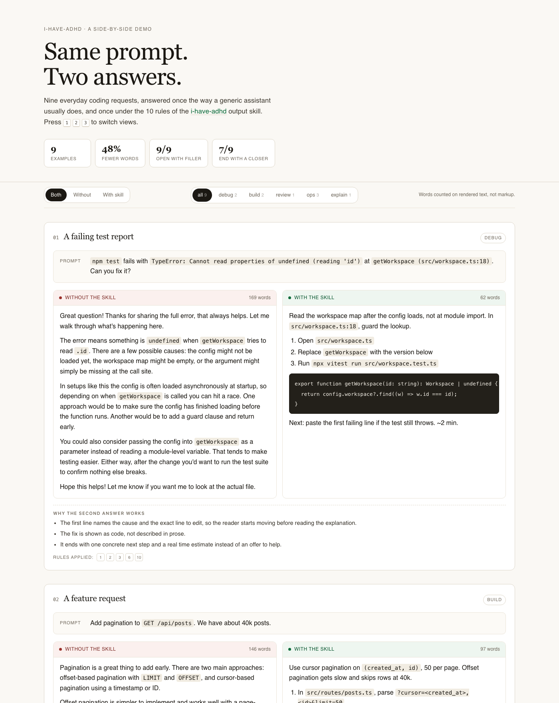

# Same prompt, two answers

A side-by-side demo of [i-have-adhd](https://github.com/ayghri/i-have-adhd), an output skill that stops a coding
agent from burying the answer. Nine ordinary requests — a failing test, a vague "it's slow", a destructive cleanup —
answered once by a generic assistant and once under the skill's 10 rules.

**Live demo: <https://somphol.github.io/i-have-adhd-demo/>**

Open `index.html` to see the comparison. No build step, no dependencies, no network.



## Why

Wording advice is easy to nod at and hard to feel. A rule like "lead with the next action" means little until you see
the same request answered both ways and notice which one you can act on without re-reading. This repo is that
comparison, plus a small gate that keeps the examples honest.

The measured difference on these nine pairs:

| | Without | With |
| --- | --- | --- |
| Words | 1,196 | 623 |
| Average cut | — | 48% |
| Opens with filler ("Great question…") | 9 / 9 | 0 / 9 |
| Ends with a closer ("Hope this helps") | 7 / 9 | 0 / 9 |
| Numbered steps across all answers | 0 | 19 |

Exact numbers come from `npm run verify`, which prints the table for the current data. The counts are not all 9/9
because a fair "before" answer does not always use every tic; two of them end with a question instead of a closer.

## Run it

```sh
git clone https://github.com/somphol/i-have-adhd-demo
cd i-have-adhd-demo
open index.html          # macOS; or: npm run serve → http://localhost:4173
```

If port 4173 is taken, `PORT=5000 npm run serve`.

To edit examples, change `data/examples.json`, not `data/examples.js`. The `.js` file is generated.

```sh
npm run build            # data/examples.json → data/examples.js
npm run verify           # build, then enforce the rules below
```

## What the verifier enforces

`scripts/verify.mjs` renders every answer with the same code the page uses (`assets/render.js`), then fails if:

1. An "after" answer opens with filler or contains a closing pleasantry.
2. It has more than five numbered steps.
3. Its last block is not a next step.
4. It is not shorter than its "before" counterpart.
5. Markdown does not render cleanly (unclosed fences, leftover `**`, unbalanced `<code>`).
6. `data/examples.js` has drifted from `data/examples.json`.

That is the point of the repo: the "after" column cannot quietly become the "before" column.

## Deploy

Pushing to `main` publishes the static files to GitHub Pages via `.github/workflows/pages.yml`. The one-time setup
for a fresh repo (create it, then point Pages at GitHub Actions) is in `PUBLISHING.md`.

## Layout

```text
index.html            the page: one file, inline CSS
assets/render.js      markdown-subset renderer + word/step counting, shared with the verifier
assets/app.js         cards, view toggle, kind filter, keyboard shortcuts
data/examples.json    the source of truth: prompts, both answers, rationale, rule tags
data/examples.js      generated for file:// use
scripts/build.mjs     JSON → JS
scripts/verify.mjs    the gate described above
.github/workflows/    verify on push/PR, deploy to Pages on main
PUBLISHING.md         the one-time steps another session needs to publish
```

## Adding an example

Add an object to `data/examples.json`:

```json
{
  "id": "kebab-case-id",
  "title": "What it shows",
  "kind": "debug | build | review | ops | explain",
  "prompt": ["One block per paragraph or fenced code block."],
  "before": ["The realistic, chatty answer."],
  "after": ["Lead with the action.", "1. Step one\n2. Step two", "Next: one concrete step. ~2 min."],
  "why": ["What the second answer does differently."],
  "rules": [1, 2, 3]
}
```

Blocks are plain strings: a paragraph, a run of `1.` lines, a run of `-` lines, or a triple-backtick fence. Lists
must be one block, one item per line. Then run `npm run verify`.

## How these were produced

The nine answers are **hand-written illustrations, not captured model transcripts**. They were written to show the
shape the skill asks for, and the "before" column deliberately reproduces the patterns the skill names — preambles,
surveys of options with no decision, closers, and offers to help instead of next steps.

If you want real pairs rather than illustrations, capture them locally:

```sh
# without the skill
opencode run "Add pagination to GET /api/posts. We have about 40k posts."

# with the skill active (start a session, run /i-have-adhd, then ask the same thing)
opencode
```

Paste both into a new entry and note in `why` what actually changed. Keep the prompt identical or the comparison is
noise.

## Limits

- The "before" answers are a fair caricature, not a benchmark. A good model already does some of this on its own.
- Word count is a proxy. The skill is about actionability; a shorter answer that omits the next step is worse, not
  better. That is why the verifier checks for a next step, not just shrinkage.
- One rule set, one taste. Fork `SKILL.md`, re-run the verifier, and the examples stop matching — which is the
  honest outcome.

## Attribution

The skill, its wording and its 10 rules belong to [ayghri/i-have-adhd](https://github.com/ayghri/i-have-adhd) (MIT).
This repo only demonstrates it and is unaffiliated. The demo code is MIT as well; see `LICENSE`.
